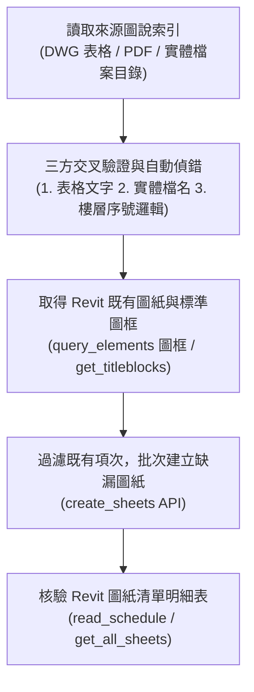

# CAD to Revit Sheet Sync (圖說索引表自動同步至 Revit 圖紙)

## Purpose

Use this skill to extract drawing index information (圖號 Sheet Number, 圖名 Sheet Name) from CAD drawings (`.dwg`), plotted PDFs, or vendor directory structures (e.g. 結構、機電、室裝、景觀圖說), perform multi-source cross-validation and typo auto-correction, and batch create corresponding Revit sheets (`ViewSheet`) using Revit MCP tools, ensuring they accurately appear in the project's **圖紙清單 (Sheet List Schedule)**.

---

## Workflow

### 1. 讀取來源圖說索引
- **CAD 圖面直接讀取**：若 AutoCAD 中開啟有 `*索引表*.dwg`（如 `S1-A00_結構圖說索引表.dwg`），可透過 AutoCAD MCP 或轉出圖面影像解析表格內容。
- **PDF 索引圖解析**：若為向量或光柵 PDF，使用 PyMuPDF (`fitz`) 取得頁面內容，必要時裁切表格區域並校正旋轉方向進行核對。
- **實體檔案目錄比對**：檢索專案目錄（如 `建照\` 或 `施工\PDF\`）下的所有圖檔檔名（常見命名格式：`圖號_圖名.dwg` 或 `圖號_圖名.pdf`）。

### 2. 三方交叉驗證與自動偵錯（核心機制）
在建立 Revit 圖紙之前，必須進行三方交叉防呆驗證，避免圖紙重複或手民之誤：
1. **表格文字 vs 實體檔名**：比對圖說索引表格內標註之圖號與目錄實體檔案檔名是否完全吻合。
2. **圖號唯一性檢查（Revit 防呆）**：Revit 嚴格禁止同一個專案中存在相同的 `SheetNumber`。若表格出現重複圖號，需觸發邏輯推導。
3. **工程命名邏輯推導**：
   - 平面圖（P 系列）通常隨樓層遞增：`P01 (1F)` $\rightarrow$ `P02 (2~3F)` $\rightarrow$ `P03 (4F~RF)`。
   - 若表格中出現重複（如將屋頂層誤植為 `P02`），系統應以實體檔名及樓層連續性判定並自動更正為 `P03`，並向使用者提示說明。

### 3. 識別 Revit 專案標準圖框 (TitleBlock)
- 透過 `revit:query_elements(category="圖框")` 或 `revit:get_titleblocks()` 取得專案使用中之圖框 FamilySymbol ID。
- 優先挑選既有圖紙所使用的標準圖框（例如 `陳敬傑建築師事務所A1`），確保新增之圖紙外觀樣式統一。

### 4. 批次建立圖紙 (Batch Creation)
- 呼叫 `revit:create_sheets`：
  - 傳入參數：`titleBlockId` 及 `sheets: [{ number: "圖號", name: "圖名" }]`。
  - 僅建立專案中尚未存在的項次，若使用者已手動填入範例（如 `S1-A00`），予以跳過並保持既有實體。

### 5. 驗證圖紙清單 (Verification)
- 呼叫 `revit:read_schedule` 讀取專案內的 **「圖紙清單」** 明細表（例如 Schedule ID `253091`）。
- 確認總列數正確增加，且新建立的圖號、圖名完整無誤呈現在清單中。
- 輸出清楚的 Markdown 對照表格供使用者覆核。

---

## 常見圖說類別代號對照

| 專業類別代號 | 領域 | 常見圖號與內容範例 |
| :---: | :--- | :--- |
| **A** | 建築 (Architectural) | `A101` 索引表/面積表、`A201` 平面圖、`A301` 立面圖、`A401` 剖面圖 |
| **S** | 結構 (Structural) | `S1-A00` 索引表、`S1-A01` 一般說明、`S1-B01` 詳圖、`S1-P01` 平面圖 |
| **M** | 空調 (Mechanical) | `M1-01` 空調設備配置圖、風管系統圖 |
| **E** | 電氣 (Electrical) | `E1-01` 電力配線圖、電燈配置圖、弱電系統圖 |
| **P** | 給排水 (Plumbing) | `P1-01` 給水平面圖、排水平面圖、昇位圖 |
| **F** | 消防 / 規劃 (Fire / Facility) | `F101` 消防平面圖、`F201` 規劃平面圖 |
| **G** | 綠建築 (Green Building) | `G101` 綠建築外殼計算式與節能圖說 |
